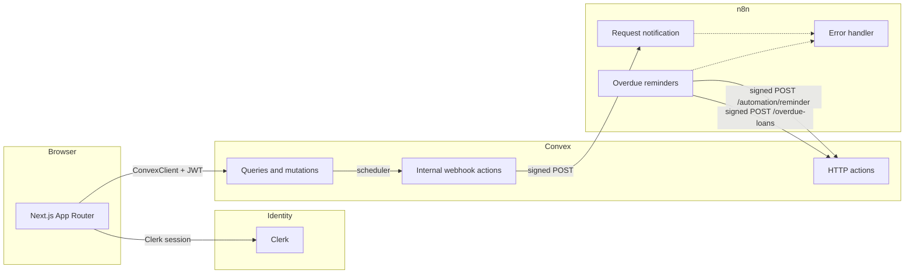

# LendLoop

Borrow what you need. Lend what you don’t.

LendLoop is a neighborhood tool-lending board. Neighbors list tools they are willing to lend, request to borrow from each other, and receive automated notifications and reminders through n8n.

This is a take-home project built with Next.js (App Router), Clerk, Convex, n8n, and TypeScript.

## Requirements covered

- Public noticeboard showing only tool **name** and **category** (no owner details).
- “Sign in to lend or borrow” through Clerk.
- Signed-in neighbors can list a tool, request a date range, approve or decline incoming requests, and mark a loan as returned.
- Authenticated browse view with availability and category filters, plus **My listings**, **My requests**, **Incoming requests**, and **Loans**.
- Two roles — `user` and `admin` — enforced in Convex functions, not only in the UI.
- Admins can remove any listing, view every loan, and mark a lender as a Trusted Lender.
- Two n8n workflows: request notifications and daily overdue reminders, plus an error-handler workflow.
- HMAC-SHA256 request signing in both directions, secrets only in environment variables, idempotent reminder write-backs, and retries with backoff.
- Recent reminder activity is shown on each loan.

## Architecture



- **Next.js** renders the public board and the signed-in workspace. It never talks to n8n directly.
- **Clerk** owns sign-in and issues a JWT. Convex validates that JWT (`convex/auth.config.ts`) and maps it to a `users` document.
- **Convex** is the source of truth for listings, requests, loans, and access control. Mutations schedule an internal action after a request is created or changes status.
- **n8n** handles notifications and the daily overdue sweep. Exported workflows live in `n8n/workflows/`.

## RBAC model

Rules live in `convex/lib/rbac.ts` and are called from the corresponding Convex mutations. The UI hides controls that would fail, but a crafted API call is still rejected on the server.

| Action | `user` | `admin` |
| --- | --- | --- |
| Create a listing | yes | yes (as themselves) |
| Edit or delete a listing | only their own | only their own (edit/delete) |
| Remove any listing | no | yes (`tools.adminRemove`) |
| Request to borrow | yes, not their own tool | yes, not their own tool |
| Approve or decline a request | only on their own tools | only on their own tools |
| Cancel a pending request | only their own | only their own |
| Mark a loan returned | lender or borrower on that loan | only if they are lender or borrower |
| View every loan | no | yes |
| Mark a Trusted Lender | no | yes |
| Public board | unauthenticated: name + category of tools that are not currently on loan | same |

Admins are not a bypass for ordinary ownership actions (approve, edit, mark returned). That keeps a stolen admin session from silently rewriting someone else’s listing; the admin tools that exist are the ones the brief asks for: remove, inspect loans, and trust a lender.

The first admin accounts are seeded by setting `ADMIN_CLERK_USER_IDS` (comma-separated Clerk user IDs) in the Convex dashboard. On the next `users.ensure` call, those identities are promoted to `admin`.

## Webhook signing and verification

Every request across the Convex ↔ n8n boundary is signed with the same secret.

- Canonical message: `` `${timestamp}.${body}` ``
- `X-LendLoop-Timestamp`: Unix seconds
- `X-LendLoop-Signature`: `v1=<hex hmac-sha256>`
- Replay window: 5 minutes
- Comparison is constant-time and length-checked
- Implementation: `convex/lib/hmac.ts` (Web Crypto, used by Convex). n8n Code nodes use Node’s `crypto` module and the same canonical string, reading the secret from `$env.LENDLOOP_WEBHOOK_SECRET`.

Outbound (Convex → n8n): `convex/webhooks.ts` signs the JSON body and POSTs it to `N8N_REQUEST_WEBHOOK_URL`. Failures retry up to five times with backoff (15s, 1m, 5m, 30m) via `ctx.scheduler`.

Inbound (n8n → Convex):

- `POST /overdue-loans` — returns overdue loans, with emails and names only because the reminder needs a destination.
- `POST /automation/reminder` — records that a reminder was sent.

Both routes live in `convex/http.ts` and return 401 if the signature is missing, wrong, or stale.

### Idempotency

The reminder write-back uses `idempotencyKey = reminder:{loanId}:{YYYY-MM-DD}`. `automationEvents` is indexed on that key. A retry with the same key returns the existing row and does not insert a second reminder. A new day produces a new key, so a still-overdue loan can be reminded again tomorrow.

## Security and privacy

- The public query returns only `name` and `category`. Owner identifiers, emails, and descriptions stay behind authentication.
- Webhook payloads are minimized: n8n receives the request status, tool name, and the single person who needs a notification. No Clerk IDs, no listing descriptions, no extra profile fields.
- Secrets never appear in source, in exported n8n JSON, or in logs. Generate a dedicated value with `openssl rand -hex 32` and put it in Convex env, n8n env, and (for local scripts) `.env.local`.
- n8n’s editor is exposed only on localhost in `docker-compose.yml`, with basic auth enabled. Do not publish that port.
- Listings are soft-deleted (`removedAt`) so an admin removal does not destroy loan history.
- Date overlap is checked before a request is approved, so two neighbors cannot be promised the same tool for the same days.

## Local setup

You will need Node 20+, Docker (for n8n), a [Clerk](https://clerk.com) application, and a [Convex](https://convex.dev) project. This repository is structured so it still **installs, tests, and builds** without those accounts. Sign-in and live data start working once the keys below are added.

### 1. Install and copy env files

```bash
npm install
cp .env.example .env.local
```

`npm test` and `npm run build` can be run now. They use placeholder keys and do not call Clerk, Convex, or n8n.

### 2. Clerk

1. Create an application in the Clerk dashboard.
2. Put the publishable and secret keys in `.env.local`.
3. Under JWT Templates, create a template named `convex` and copy the Issuer URL into `CLERK_JWT_ISSUER_DOMAIN` (and into the Convex dashboard as the same variable).
4. Set the sign-in and sign-up paths already listed in `.env.example`.

### 3. Convex

```bash
npx convex dev
```

This creates a deployment, writes `CONVEX_DEPLOYMENT`, regenerates `convex/_generated/*`, and prints `NEXT_PUBLIC_CONVEX_URL`. Add these Convex environment variables in the dashboard (or `npx convex env set`):

| Variable | Purpose |
| --- | --- |
| `CLERK_JWT_ISSUER_DOMAIN` | JWT issuer, must match the Clerk template |
| `LENDLOOP_WEBHOOK_SECRET` | Shared HMAC secret |
| `N8N_REQUEST_WEBHOOK_URL` | n8n webhook, e.g. `http://localhost:5678/webhook/lendloop-request` (use a tunnel or a deployed n8n URL if Convex cannot reach localhost) |
| `ADMIN_CLERK_USER_IDS` | Optional. Comma-separated Clerk user IDs granted the admin role |

The HTTP site URL (`https://<deployment>.convex.site`) is what n8n calls. Copy it to `CONVEX_SITE_URL` in the shell environment you use for Docker Compose.

If Convex Cloud cannot reach `localhost`, run n8n with a public URL, or use a tunnel, and put that webhook URL in `N8N_REQUEST_WEBHOOK_URL`.

### 4. n8n

```bash
# same folder, with LENDLOOP_WEBHOOK_SECRET and CONVEX_SITE_URL exported
docker compose up -d
```

Open http://localhost:5678, sign in to the editor, and import, in order:

1. `n8n/workflows/error-handler.json`
2. `n8n/workflows/request-notification.json`
3. `n8n/workflows/overdue-reminders.json`

Then, on the two feature workflows, open **Settings → Error Workflow** and attach **LendLoop – Error handler**. Workflow IDs change on import, so the link cannot be hardcoded in the JSON. Activate the workflows.

The request-notification webhook path is `lendloop-request`. After activation, n8n shows the full URL — put that in `N8N_REQUEST_WEBHOOK_URL`.

Notifications are **logged mocks** (`console.log` in a Code node), which the brief allows. Swap those nodes for Email, Slack, or Discord and keep the same minimized fields.

### 5. Run the app

```bash
npx convex dev    # terminal 1
npm run dev       # terminal 2
```

Open http://localhost:3000.

Optional: set `NEXT_PUBLIC_PREVIEW_FIXTURES=1` to show clearly labelled sample tools on the public page when Convex is not connected. It is off by default.

## Environment variables

See `.env.example` for the full list and comments. Summary:

**Next.js (`.env.local`)**

- `NEXT_PUBLIC_CLERK_PUBLISHABLE_KEY`, `CLERK_SECRET_KEY`
- `NEXT_PUBLIC_CLERK_SIGN_IN_URL`, `NEXT_PUBLIC_CLERK_SIGN_UP_URL`
- `NEXT_PUBLIC_CONVEX_URL`
- `NEXT_PUBLIC_PREVIEW_FIXTURES` (optional)

**Convex dashboard**

- `CLERK_JWT_ISSUER_DOMAIN`
- `LENDLOOP_WEBHOOK_SECRET`
- `N8N_REQUEST_WEBHOOK_URL`
- `ADMIN_CLERK_USER_IDS`

**n8n / Docker Compose**

- `LENDLOOP_WEBHOOK_SECRET` (must match Convex)
- `CONVEX_SITE_URL` (passed through as `LENDLOOP_CONVEX_SITE_URL`)
- `N8N_BASIC_AUTH_USER`, `N8N_BASIC_AUTH_PASSWORD`

## Tests

```bash
npm test
```

The tests do not need Clerk, Convex, or n8n accounts. They cover:

- HMAC signing, tamper detection, and replay-window rejection
- Every access-control rule in `convex/lib/rbac.ts`
- Date validation, overlap, and overdue calculation
- Idempotent reminder keys and retry behaviour

## Production notes

If this were going into production, I would change at least the following:

- Replace the logged mock notifications with a real email (or Slack) provider, still sending only the fields those messages need.
- Keep n8n on a private network. Convex should call it over TLS, and n8n should not have an editor port on the public internet.
- Store `LENDLOOP_WEBHOOK_SECRET` in a secret manager and rotate it. Consider a second secret during rotation so in-flight signatures still verify.
- Put a rate limit and request-size cap on the Convex HTTP routes.
- Use Clerk webhooks (signed) to deactivate a `users` row when an account is deleted, instead of only syncing on sign-in.
- Add structured delivery metrics for webhook attempts, and an admin view of `webhookDeliveries`.
- Persist n8n workflow state in a real database, with backups, rather than a local Docker volume.
- Tighten CORS and cookie settings on the Next.js deployment, and run an accessibility pass on the forms.
- Decide a retention period for loan and automation records, especially emails captured for reminders.

## Project layout

```
convex/                 schema, queries, mutations, HTTP routes, webhook actions
convex/lib/             HMAC, RBAC, dates, categories (also imported by tests)
n8n/workflows/          exported n8n workflows, no secrets
src/app/                Next.js App Router pages
src/components/         UI
tests/                  Vitest unit tests
docker-compose.yml      local n8n
```

## Scripts

| Command | What it does |
| --- | --- |
| `npm test` | Unit tests |
| `npm run dev` | Next.js dev server |
| `npx convex dev` | Convex dev / codegen |
| `npm run build` | Production Next.js build (works with placeholder keys) |
| `docker compose up -d` | Local n8n |
